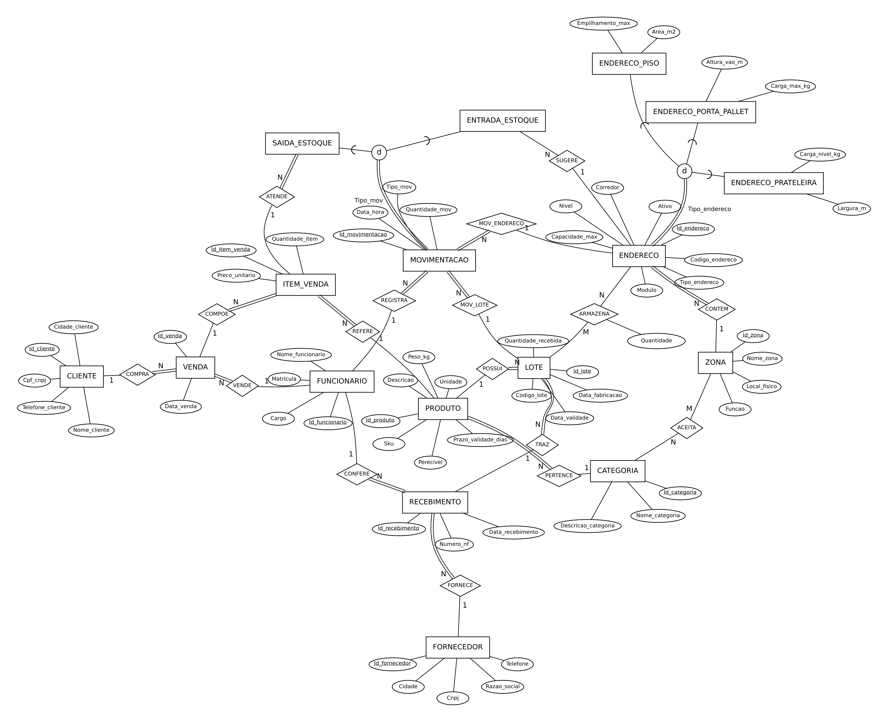

# Depósito FIFO

Banco de dados para **endereçamento e controle de estoque** da área de armazenagem e expedição de uma loja de material de construção. O sistema sabe **onde** está cada lote, sugere **onde guardar** o que chega e decide **de qual lote e endereço tirar** o que foi vendido, pela regra **validade primeiro, depois FIFO**.

Feito em PostgreSQL 16, com a modelagem (EER → relacional) na notação de Elmasri e Navathe.

<!-- Depois de publicar, troque USUARIO/REPOSITORIO para ativar o selo dos testes:

-->



## O que o banco faz

- **Endereçamento:** cada endereço (porta-pallet, prateleira ou piso) pertence a uma zona, e cada zona aceita só certas categorias de produto.
- **Sugestão de endereço:** na entrada, o banco sugere um endereço ativo, de zona compatível e com espaço. Ele prefere juntar o produto onde já existe, depois a reserva, depois o encaixe mais justo.
- **Saída FIFO + validade:** na venda, o banco tira primeiro do lote que vence antes; no empate, do que chegou antes; dentro do lote, do picking antes da reserva. Lotes vencidos são ignorados.
- **Saldo automático:** cada entrada ou saída atualiza o saldo por lote e endereço via gatilho. Não há `UPDATE` manual de estoque.
- **Rastreabilidade:** dá para seguir um lote da nota fiscal até o cliente (útil em recall).
- **Histórico imutável:** movimentações não podem ser alteradas nem apagadas.

## Como rodar

### Com Docker (recomendado)

```bash
docker compose up -d
```

Na primeira subida, o PostgreSQL executa os scripts de `db/` e o banco fica pronto com dados de exemplo. Para abrir o terminal SQL:

```bash
docker compose exec db psql -U deposito -d bd_deposito
```

Para rodar os testes e um relatório:

```bash
docker compose exec db psql -U deposito -d bd_deposito -f /tests/testes_regras.sql
docker compose exec db psql -U deposito -d bd_deposito -f /queries/01_fila_fifo.sql
```

Para recriar tudo do zero, use `docker compose down -v` e depois `docker compose up -d`. Com `make`, os atalhos são `make up`, `make test`, `make consultas` e `make reset`.

### Sem Docker (PostgreSQL já instalado)

```bash
PGUSER=postgres ./scripts/criar_banco_local.sh
PGUSER=postgres ./scripts/rodar_testes.sh
psql -U postgres -d bd_deposito -f queries/01_fila_fifo.sql
```

No Windows sem Bash, rode os arquivos de `db/` em ordem no psql ou no pgAdmin, dentro de um banco `bd_deposito` vazio.

## Estrutura

```
db/
  01_schema.sql          19 tabelas, chaves, CHECKs e índices (o mapeamento EER)
  02_regras.sql          gatilhos e funções: saldo, validações, especialização, FIFO
  03_visoes.sql          visões usadas pelos relatórios
  04_dados_exemplo.sql   carga fictícia com datas relativas a hoje
queries/                 relatórios prontos (fila FIFO, validade, ocupação, rastreio...)
tests/testes_regras.sql  27 testes automáticos (rodam em transação com ROLLBACK)
docs/mapeamento.md       como e por que o EER virou estas tabelas
docs/img/                diagrama EER e esquema relacional (PNG e SVG)
scripts/                 criação do banco e testes sem Docker
.github/workflows/       roda os testes a cada push (GitHub Actions)
```

## Exemplo: uma venda de 50 sacos de cimento

`queries/08_exemplo_venda.sql` registra a venda e chama a separação FIFO. O resultado dentro de uma transação desfeita no fim é este:

```
-- fila antes                                    -- o que a função separou
 ordem | lote   | validade   | endereço | qtd     lote   | endereço | qtd
-------+--------+------------+----------+-----    -------+----------+-----
     1 | CIM-A2 | vence 1º   | A-01-2   |   5     CIM-A2 | A-01-2   |   5
     2 | CIM-A2 | vence 1º   | A-01-1   |  40     CIM-A2 | A-01-1   |  40
     3 | CIM-B1 | vence 2º   | X-01-0   |  10     CIM-B1 | X-01-0   |   5
     4 | CIM-B1 | vence 2º   | P-01-0   |  80
```

O lote `CIM-A1`, que venceu, ainda está no endereço X-01-0, mas não entra na fila. Ele aparece em `queries/02_validade.sql` para ser retirado.

## Como usar no dia a dia

```sql
-- Entrada: lote 3, 20 unidades, funcionário 2, endereço sugerido pelo banco
SELECT fn_registrar_entrada(3, 20, 2);

-- Entrada num endereço escolhido (o banco valida zona, capacidade e validade)
SELECT fn_registrar_entrada(3, 20, 2, 5);

-- Saída do item de venda 7 pela regra FIFO + validade
SELECT * FROM fn_registrar_saida_fifo(7, 4);

-- Onde guardar 30 unidades do lote 9?
SELECT Codigo_endereco FROM ENDERECO WHERE Id_endereco = fn_sugerir_endereco(9, 30);
```

## Regras garantidas pelo banco

| # | Regra | Onde |
|---|---|---|
| R1 | Especialização total e disjunta de ENDERECO e MOVIMENTACAO | gatilhos `TG_*_TIPO` (imediato) e `TG_*_TOTAL` (adiado para o COMMIT) |
| R2 | Saldo = entradas − saídas, por lote e endereço | `TG_MOV_SALDO` |
| R3 | Entrada só em endereço ativo, de zona que aceita a categoria e com espaço | `TG_MOV_VALIDA` |
| R4 | Lote vencido não entra nem sai | `TG_MOV_VALIDA` |
| R5 | Saída do produto vendido, sem passar da quantidade | `TG_SAIDA_ITEM` |
| R6 | Movimentações não podem ser alteradas nem apagadas | `TG_MOV_IMUTAVEL` |
| R7 | Sugestão de endereço e separação FIFO | `fn_sugerir_endereco`, `fn_registrar_saida_fifo` |

Cada regra tem pelo menos um teste em `tests/testes_regras.sql`.

## Decisões de modelagem

O passo a passo do mapeamento está em [docs/mapeamento.md](docs/mapeamento.md). Em resumo:

- chaves substitutas inteiras, com as chaves naturais (SKU, CNPJ, código do endereço) como `UNIQUE`;
- os relacionamentos 1:N viram FK, `NOT NULL` quando a participação é total; só SUGERE é parcial;
- os M:N viram tabela: ZONA_CATEGORIA (ACEITA) e ESTOQUE_ENDERECO (ARMAZENA, que guarda o saldo);
- as especializações usam a opção 8A (superclasse + subclasses com PK = FK), reforçada por gatilhos.

## Limitações conhecidas

- A capacidade do endereço é contada em unidades do produto, sem converter entre sacos, galões e caixas. Uma evolução seria usar volume ou peso (`Peso_kg` já existe).
- Não há estorno: um erro de lançamento ainda precisa de uma movimentação de ajuste, que não foi modelada.
- Não há inventário (contagem física comparada ao saldo do sistema).

## Próximos passos

- [ ] Movimentação de transferência entre endereços e de ajuste/estorno
- [ ] Inventário cíclico
- [ ] API (por exemplo FastAPI ou Spring) expondo entrada, saída e relatórios
- [ ] Tela de separação para o operador
- [ ] Usuários e permissões no banco (conferente, vendedor, gerente)

## Autores

Trabalho prático da disciplina de Banco de Dados (2026).

- Danilo Djovano Selli Junior
- _(adicionar integrantes do grupo)_

## Licença

_(a definir pelo grupo; MIT é a opção mais comum para portfólio)_
