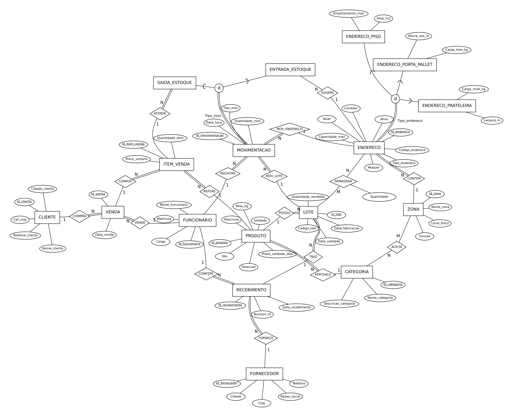
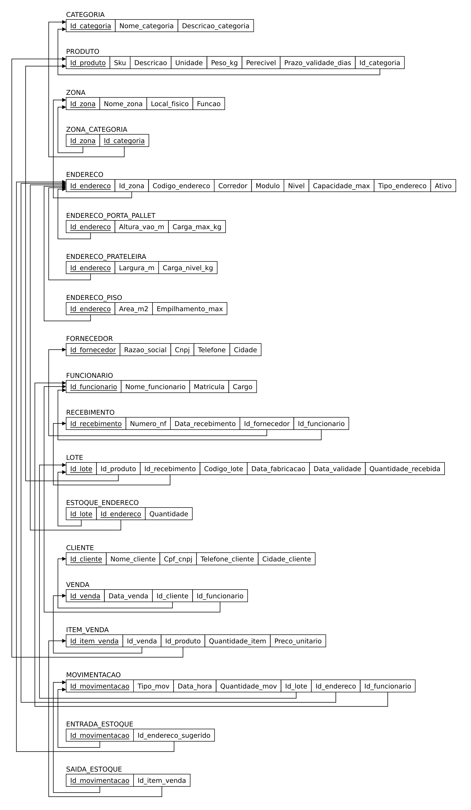

# Mapeamento EER → relacional

Este documento explica como o esquema conceitual (EER) virou as 19 tabelas de `db/01_schema.sql`. A notação e o algoritmo seguem o livro-texto da disciplina: Elmasri e Navathe, *Sistemas de Banco de Dados*, 7ª edição (Pearson). O algoritmo tem 9 passos. Os passos 1 a 7 tratam o modelo ER e os passos 8 e 9 tratam o EER.

| Diagrama EER | Esquema relacional |
|---|---|
|  |  |

As versões em SVG (vetoriais) estão em `docs/img/`.

## Passo 1: entidades regulares

Cada tipo de entidade regular vira uma relação. A chave primária é sempre uma **chave substituta inteira** (`Id_...`, `GENERATED BY DEFAULT AS IDENTITY`), e as chaves naturais do EER viram restrições `UNIQUE`:

| Relação | Chave primária | Chave secundária (UNIQUE) |
|---|---|---|
| CATEGORIA | Id_categoria | Nome_categoria |
| PRODUTO | Id_produto | Sku |
| FORNECEDOR | Id_fornecedor | Cnpj |
| FUNCIONARIO | Id_funcionario | Matricula |
| CLIENTE | Id_cliente | Cpf_cnpj |
| ZONA | Id_zona | Nome_zona |
| ENDERECO | Id_endereco | Codigo_endereco |
| RECEBIMENTO | Id_recebimento | (Numero_nf, Id_fornecedor) |
| LOTE | Id_lote | (Id_produto, Codigo_lote) |
| VENDA | Id_venda | — |
| ITEM_VENDA | Id_item_venda | (Id_venda, Id_produto) |
| MOVIMENTACAO | Id_movimentacao | — |

**Por quê:** SKU, CNPJ e código de endereço podem mudar (troca de fornecedor, re-endereçamento do galpão). Com chave inteira, a mudança não se propaga para as chaves estrangeiras. O número da nota fiscal só é único por fornecedor, por isso a chave secundária de RECEBIMENTO é composta.

## Passo 2: entidades fracas (não se aplica)

Havia duas candidatas, e ambas foram tratadas como regulares:

- **ITEM_VENDA** poderia ser fraca de VENDA. Ganhou chave própria porque SAIDA_ESTOQUE a referencia; com chave composta, essa FK teria duas colunas. A regra "um produto por venda" ficou em `UNIQUE (Id_venda, Id_produto)`.
- **LOTE** poderia ser fraca de PRODUTO (chave parcial `Codigo_lote`). Pelo mesmo motivo (é referenciado por ESTOQUE_ENDERECO e MOVIMENTACAO), recebeu `Id_lote`, com `UNIQUE (Id_produto, Codigo_lote)`.

## Passo 3: relacionamentos 1:1 (não se aplica)

As únicas ligações 1:1 do modelo são entre superclasse e subclasse, tratadas no Passo 8.

## Passo 4: relacionamentos 1:N

Abordagem de **chave estrangeira**: a chave do lado 1 entra como FK na relação do lado N. A participação decide o nulo: **total → `NOT NULL`**, **parcial → aceita `NULL`**.

| Relacionamento | Lado 1 → lado N | Coluna FK | Participação do lado N |
|---|---|---|---|
| PERTENCE | CATEGORIA → PRODUTO | PRODUTO.Id_categoria | total |
| CONTEM | ZONA → ENDERECO | ENDERECO.Id_zona | total |
| POSSUI | PRODUTO → LOTE | LOTE.Id_produto | total |
| FORNECE | FORNECEDOR → RECEBIMENTO | RECEBIMENTO.Id_fornecedor | total |
| CONFERE | FUNCIONARIO → RECEBIMENTO | RECEBIMENTO.Id_funcionario | total |
| TRAZ | RECEBIMENTO → LOTE | LOTE.Id_recebimento | total |
| COMPRA | CLIENTE → VENDA | VENDA.Id_cliente | total |
| VENDE | FUNCIONARIO → VENDA | VENDA.Id_funcionario | total |
| COMPOE | VENDA → ITEM_VENDA | ITEM_VENDA.Id_venda | total |
| REFERE | PRODUTO → ITEM_VENDA | ITEM_VENDA.Id_produto | total |
| MOV_LOTE | LOTE → MOVIMENTACAO | MOVIMENTACAO.Id_lote | total |
| MOV_ENDERECO | ENDERECO → MOVIMENTACAO | MOVIMENTACAO.Id_endereco | total |
| REGISTRA | FUNCIONARIO → MOVIMENTACAO | MOVIMENTACAO.Id_funcionario | total |
| **SUGERE** | ENDERECO → ENTRADA_ESTOQUE | ENTRADA_ESTOQUE.Id_endereco_sugerido | **parcial** |
| ATENDE | ITEM_VENDA → SAIDA_ESTOQUE | SAIDA_ESTOQUE.Id_item_venda | total |

**Alternativa descartada:** a relação de relacionamento (referência cruzada), uma tabela só com as duas chaves. Ela compensa quando poucas tuplas participam, para evitar nulos. Aqui 14 dos 15 relacionamentos são totais; a tabela extra só acrescentaria junções. SUGERE é o único parcial, e mesmo assim a sugestão costuma existir, então a FK com `NULL` é suficiente.

## Passo 5: relacionamentos M:N

Cada M:N vira uma tabela própria, com as duas chaves como PK composta e os atributos do relacionamento:

| Relacionamento | Entidades | Tabela | Chave primária | Atributo |
|---|---|---|---|---|
| ACEITA | ZONA × CATEGORIA | ZONA_CATEGORIA | (Id_zona, Id_categoria) | — |
| ARMAZENA | LOTE × ENDERECO | ESTOQUE_ENDERECO | (Id_lote, Id_endereco) | Quantidade |

ESTOQUE_ENDERECO é o **saldo**: um lote pode estar dividido em vários endereços, e um endereço guarda vários lotes. A quantidade depende do par, por isso fica ali.

## Passo 6: atributos multivalorados (não se aplica)

Cada fornecedor e cliente tem um único telefone. Se houvesse vários, surgiria `TELEFONE_CLIENTE (Id_cliente, Telefone)`.

## Passo 7: relacionamentos n-ários (não se aplica)

A movimentação envolve lote, endereço e funcionário e poderia ser um relacionamento ternário. Foi modelada como **entidade** (MOVIMENTACAO) porque tem identidade, data/hora e subclasses; liga-se às três entidades por três 1:N (Passo 4).

## Passo 8: especialização / generalização

| Opção | Como mapeia | Quando pode ser usada |
|---|---|---|
| 8A | superclasse + uma relação por subclasse (PK da subclasse = FK para a superclasse) | qualquer caso |
| 8B | só as subclasses, com os atributos herdados | só especialização total |
| 8C | uma relação com atributo de tipo | só subclasses disjuntas (gera nulos) |
| 8D | uma relação com um booleano por subclasse | subclasses sobrepostas |

**ENDERECO (total e disjunta, `Tipo_endereco ∈ {PP, PR, PI}`): opção 8A.** A 8B não serve porque ZONA, ESTOQUE_ENDERECO, MOVIMENTACAO e ENTRADA_ESTOQUE precisam referenciar *qualquer* endereço; sem a relação ENDERECO, a FK teria de apontar para três tabelas. A 8C deixaria 4 dos 6 atributos específicos nulos em cada linha.

**MOVIMENTACAO (total e disjunta, `Tipo_mov ∈ {E, S}`): opção 8A.** A 8C seria possível (só um atributo por subclasse), mas cada subclasse tem um relacionamento próprio (SUGERE e ATENDE). Com 8A, `SAIDA_ESTOQUE.Id_item_venda` é simplesmente `NOT NULL`.

As subclasses usam `ON DELETE CASCADE`: apagar o endereço apaga sua parte específica.

**Limitação do modelo relacional e como foi resolvida:** "total e disjunta" exige que cada tupla da superclasse esteja em exatamente a subclasse do seu tipo. Chaves e FKs não garantem isso. O arquivo `db/02_regras.sql` resolve com dois gatilhos por especialização:

- na subclasse, um gatilho imediato confere se o tipo da superclasse bate (**disjunção**);
- na superclasse, um *constraint trigger* adiado para o `COMMIT` confere se a linha da subclasse existe (**participação total**). Por isso superclasse e subclasse são inseridas na mesma transação.

## Passo 9: categorias / tipos união (não se aplica)

Nenhuma entidade é subclasse de superclasses diferentes.

## Restrições do modelo levadas para o banco

| Restrição | Onde |
|---|---|
| Perecível tem prazo de validade; não perecível não tem | `CHECK CK_PRODUTO_VALIDADE` |
| Validade ≥ fabricação | `CHECK CK_LOTE_DATAS` |
| Saldo nunca negativo | `CHECK CK_EE_QUANTIDADE` + gatilho de saldo |
| Quantidades maiores que zero | `CHECK` em MOVIMENTACAO e ITEM_VENDA |
| Domínios (tipo, local, função, ativo) | `CHECK ... IN (...)` |
| Um produto por venda | `UNIQUE UQ_ITEM_VENDA_PRODUTO` |
| Capacidade do endereço, zona aceita a categoria, endereço ativo | gatilho `TG_MOV_VALIDA` |
| Lote vencido não entra nem sai | gatilho `TG_MOV_VALIDA` |
| Saída do produto certo, sem passar do vendido | gatilho `TG_SAIDA_ITEM` |
| Especialização total e disjunta | gatilhos `TG_*_TIPO` e `TG_*_TOTAL` |
| Histórico imutável | gatilho `TG_MOV_IMUTAVEL` |
